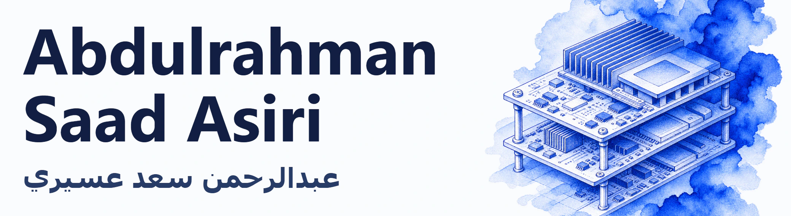
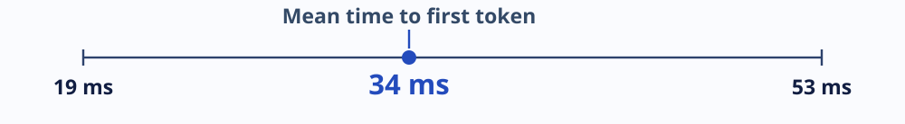
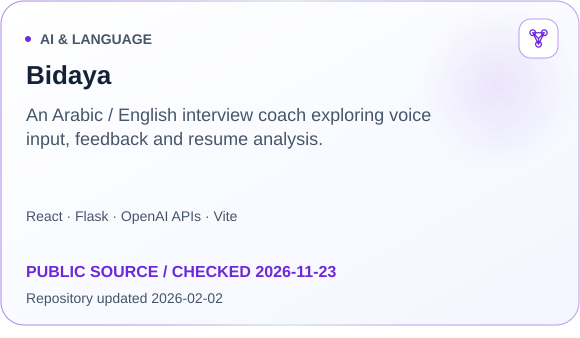
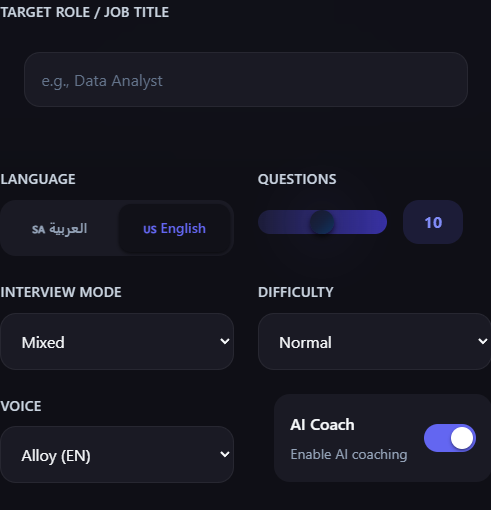

<h1><picture>
  <source media="(max-width: 900px) and (prefers-color-scheme: dark)" srcset="assets/blue-ink/masthead-mobile-dark.webp">
  <source media="(max-width: 900px) and (prefers-color-scheme: light)" srcset="assets/blue-ink/masthead-mobile-light.webp">
  <source media="(prefers-color-scheme: dark)" srcset="assets/blue-ink/masthead-dark.webp">
  <source media="(prefers-color-scheme: light)" srcset="assets/blue-ink/masthead-light.webp">
  
</picture></h1>

**Data Engineer at stc · Riyadh** 
I build data systems, Arabic AI applications and tools for market research.

[Selected work](#selected-work) · [Research](#research-and-community)

## ServeDoctorBench

**A healthy vLLM run · تشغيل مرجعي**

<picture>
  <source media="(max-width: 900px) and (prefers-color-scheme: dark)" srcset="assets/blue-ink/ttft-mobile-dark.svg">
  <source media="(max-width: 900px) and (prefers-color-scheme: light)" srcset="assets/blue-ink/ttft-mobile-light.svg">
  <source media="(prefers-color-scheme: dark)" srcset="assets/blue-ink/ttft-dark.svg">
  <source media="(prefers-color-scheme: light)" srcset="assets/blue-ink/ttft-light.svg">
  
</picture>

On an **A100-SXM4-80GB**, I measured **24 requests** after excluding **3 warm-ups**. Time to first token ranged from **19–53 ms**, with a mean of **34 ms**.

[My role and measurement · دوري في البحث](docs/research/servedoctorbench-case-study.md) · [Team poster (PDF)](docs/research/Tasaru_A0_ServeDoctorBench.pdf)

<!-- portfolio:start -->

## Selected work · أعمال مختارة

<picture>
  <source media="(max-width: 900px) and (prefers-color-scheme: dark)" srcset="assets/portfolio/saudi-market-intelligence-mobile-dark.svg">
  <source media="(max-width: 900px) and (prefers-color-scheme: light)" srcset="assets/portfolio/saudi-market-intelligence-mobile-light.svg">
  <source media="(prefers-color-scheme: dark)" srcset="assets/portfolio/saudi-market-intelligence-dark.svg">
  <source media="(prefers-color-scheme: light)" srcset="assets/portfolio/saudi-market-intelligence-light.svg">
  
</picture>

<a href="https://github.com/Abdulrahman-S-Asiri/saudi-market-intelligence">Saudi Market Intelligence repository</a> · <a href="https://github.com/Abdulrahman-S-Asiri/saudi-market-intelligence/blob/7a43abebfd509111ec2f8452c440a79576922be3/README.md">Architecture and API</a>

<picture>
  <source media="(max-width: 900px) and (prefers-color-scheme: dark)" srcset="assets/portfolio/bidaya-mobile-dark.svg">
  <source media="(max-width: 900px) and (prefers-color-scheme: light)" srcset="assets/portfolio/bidaya-mobile-light.svg">
  <source media="(prefers-color-scheme: dark)" srcset="assets/portfolio/bidaya-dark.svg">
  <source media="(prefers-color-scheme: light)" srcset="assets/portfolio/bidaya-light.svg">
  
</picture>

<a href="https://github.com/Abdulrahman-S-Asiri/Bidaya_v2">Bidaya repository</a>

Bidaya preview and sources

An Arabic / English interview coach exploring voice input, feedback and resume analysis.

<em>Interface preview · Configure a bilingual interview practice session.</em>

<a href="https://github.com/Abdulrahman-S-Asiri/Bidaya_v2/blob/ded111aa503513051378a9f3e7c7e789516ba4bd/README.md">Project guide</a> · <a href="https://github.com/Abdulrahman-S-Asiri/Bidaya_v2/blob/ded111aa503513051378a9f3e7c7e789516ba4bd/frontend/src/pages/Home.jsx">Interface source</a>

More projects

<ul>
<li><strong><a href="https://github.com/Abdulrahman-S-Asiri/Data_Science_Basics">Data Science Basics</a></strong> — A bilingual Arabic / English learning path from data fundamentals to applied notebooks.</li>
<li><strong><a href="https://github.com/Abdulrahman-S-Asiri/sentiment-analysis-project-Final">Sentiment Insight</a></strong> — Transformer-based sentiment analysis with an inference API and a branded web interface.</li>
<li><strong><a href="https://github.com/Abdulrahman-S-Asiri/Mindmaps">Mindmaps Encyclopedia</a></strong> — Interactive technical knowledge maps with generated HTML references and a navigation portal.</li>
<li><strong><a href="https://github.com/Abdulrahman-S-Asiri/tasamuh-vr">Tasamuh VR</a></strong> — An Arabic-first web VR experience exploring tolerance, justice and revenge.</li>
<li><strong><a href="https://github.com/Abdulrahman-S-Asiri/Cyber-Awareness">Cyber-Awareness</a></strong> — Arabic cybersecurity awareness training with interactive scenarios and incident-response guidance.</li>
</ul>

Private work · Published summaries

These descriptions were previously published on this profile.

<ul>
<li><strong>Stock Agents</strong> — A private investment-analysis platform exploring specialized agents, market data and portfolio tools.</li>
<li><strong>CodeForge</strong> — Private developer-workflow and platform tooling with infrastructure automation.</li>
<li><strong>Stock_101</strong> — A private Python workspace for stock-market research, technical review and organized observations.</li>
</ul>

Sources, releases and workflow checks

Public sources checked on 2026-11-23 UTC.

<ul>
<li><strong>Saudi Market Intelligence</strong> · Verified 2026-11-23 No stable release reported · No completed workflow reported</li>
<li><strong>Data Science Basics</strong> · Verified 2026-11-23 No stable release reported · No completed workflow reported</li>
<li><strong>Bidaya</strong> · Verified 2026-11-23 No stable release reported · No completed workflow reported</li>
<li><strong>Sentiment Insight</strong> · Verified 2026-11-23 No stable release reported · No completed workflow reported</li>
<li><strong>Mindmaps Encyclopedia</strong> · Verified 2026-11-23 No stable release reported · <a href="https://github.com/Abdulrahman-S-Asiri/Mindmaps/actions/runs/22548619511">pages build and deployment: success</a> · 2026-11-22</li>
<li><strong>Tasamuh VR</strong> · Verified 2026-11-23 No stable release reported · No completed workflow reported</li>
<li><strong>Cyber-Awareness</strong> · Verified 2026-11-23 No stable release reported · No completed workflow reported</li>
</ul>

Public repository discovery is current. Included repositories can opt in with the <code>portfolio-profile</code> topic.

<!-- portfolio:end -->

## Research and community · البحث والمجتمع

| Work listed in this portfolio | Focus |
|:---|:---|
| [SA-Retrieval Embeddings 0.2B](https://huggingface.co/Omartificial-Intelligence-Space/SA-Retrieval-Embeddings-0.2B) | Retrieval for Saudi Arabic and Modern Standard Arabic |
| [SAFIR Leaderboard](https://huggingface.co/spaces/NAMAA-Space/SAFIR-Leaderboard) | Arabic AI benchmarks and model evaluation |
| [ServeDoctorBench · Research Poster (PDF)](docs/research/Tasaru_A0_ServeDoctorBench.pdf) | Tuwaiq Academy Demo Day 2026 team poster. We compared how seven language models diagnosed faults, cited evidence and chose safe next actions across 62 vLLM serving cases. |

Model-specific metrics, datasets and evaluation assumptions belong with their original sources.

## Education and experience · التعليم والخبرة

I work in data engineering at **stc** in Riyadh and hold a **B.Sc. in Computer Science** from Majmaah University.

- **Data Science & AI Bootcamp** · Tuwaiq Academy, 2025. Exploratory analysis, model evaluation and NLP.
- **Tasaru · AI Infrastructure Bootcamp** · Tuwaiq Academy, June–August 2026. GPU performance, LLM serving and agents.

What I studied at Tuwaiq · ما درسته في طويق

**Data science and AI.** I studied exploratory data analysis, regression and classification, cross-validation and text preprocessing for NLP. [Bootcamp at Tuwaiq Academy](https://tuwaiq.edu.sa/bootcamp/w8z310gY/view)

In my loan-classification exercise, I dropped a score that could reveal the approval decision. Logistic regression then classified 375 of 400 held-out synthetic applications correctly. [View the notebook and confusion matrix](docs/learning/loan-approval.ipynb)

| Actual outcome | Predicted rejection | Predicted approval |
|:---|---:|---:|
| Rejected | 213 | 11 |
| Approved | 14 | 162 |

**Tasaru.** I studied how to profile GPU workloads, distribute model training across GPUs and serve language models. The labs covered attention, KV caching and agents that call tools. Our team explored how models diagnose faults in a running vLLM service. [Tasaru at Tuwaiq Academy](https://tuwaiq.edu.sa/bootcamp/qNKbNKnX/view) · [Team research poster (PDF)](docs/research/Tasaru_A0_ServeDoctorBench.pdf)

Skills, background and how I work · المهارات ومنهجي

| Area | Tools and interests |
|:---|:---|
| Data engineering | Python, SQL, pandas, NumPy, PostgreSQL, Redis, Jupyter, Tableau |
| Models and evaluation | PyTorch, TensorFlow, Transformers, scikit-learn, XGBoost, embeddings, RAG, LLM agents |
| Applications and delivery | FastAPI, Flask, REST APIs, WebSockets, TypeScript, JavaScript, React, Next.js, Vite, Tailwind CSS, Git, Docker, Terraform, GitHub Actions |
| Market research | Tadawul, US equities, technical analysis, portfolio analytics |

I start with a question, define what to measure and test the main workflow and its failure cases. I document the limits of the evidence and disclose meaningful AI assistance. [Engineering method](docs/AI_ENGINEERING_METHOD.md) · [Repository launch playbook](docs/REPO_LAUNCH_PLAYBOOK.md)

My background includes DataCamp’s Data Scientist Associate, NVIDIA’s Deep Learning Fundamentals, and leading the Investment Committees and Financial Analysis at the Investment Club. I’m studying production LLM architecture and the Chartered Market Technician program as a CMT candidate.

## Connect · تواصل

[LinkedIn](https://www.linkedin.com/in/abdulrahman-saad-asiri-573ba1200) · [Email](mailto:abdulrahman.s.alasiri@gmail.com) · [Hugging Face](https://huggingface.co/Abdulrahman-S-Asiri) · [X](https://x.com/D7oomyStay)
