<!-- The portfolio block is generated. Edit the profile copy below or portfolio/projects.json. -->
<!-- portfolio:start -->

<picture>
  <source media="(max-width: 600px) and (prefers-color-scheme: dark)" srcset="assets/portfolio/banner-mobile-dark.svg">
  <source media="(max-width: 600px) and (prefers-color-scheme: light)" srcset="assets/portfolio/banner-mobile-light.svg">
  <source media="(prefers-color-scheme: dark)" srcset="assets/portfolio/banner-dark.svg">
  <source media="(prefers-color-scheme: light)" srcset="assets/portfolio/banner-light.svg">
  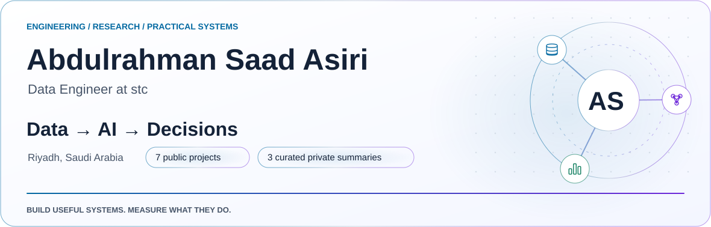
</picture>

Public sources checked on <strong>2026-11-25 UTC</strong> · 7/7 source checks succeeded

<a href="#selected-work">Selected work</a> · <a href="#research-and-community">Research</a>

<picture>
  <source media="(max-width: 600px) and (prefers-color-scheme: dark)" srcset="assets/portfolio/map-mobile-dark.svg">
  <source media="(max-width: 600px) and (prefers-color-scheme: light)" srcset="assets/portfolio/map-mobile-light.svg">
  <source media="(prefers-color-scheme: dark)" srcset="assets/portfolio/map-dark.svg">
  <source media="(prefers-color-scheme: light)" srcset="assets/portfolio/map-light.svg">
  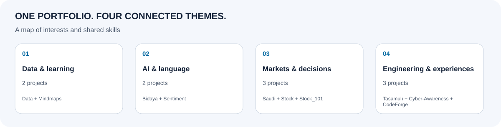
</picture>

## Selected work · مشاريع مختارة

<a href="https://github.com/Abdulrahman-S-Asiri/saudi-market-intelligence"><picture>
  <source media="(max-width: 600px) and (prefers-color-scheme: dark)" srcset="assets/portfolio/saudi-market-intelligence-mobile-dark.svg">
  <source media="(max-width: 600px) and (prefers-color-scheme: light)" srcset="assets/portfolio/saudi-market-intelligence-mobile-light.svg">
  <source media="(prefers-color-scheme: dark)" srcset="assets/portfolio/saudi-market-intelligence-dark.svg">
  <source media="(prefers-color-scheme: light)" srcset="assets/portfolio/saudi-market-intelligence-light.svg">
  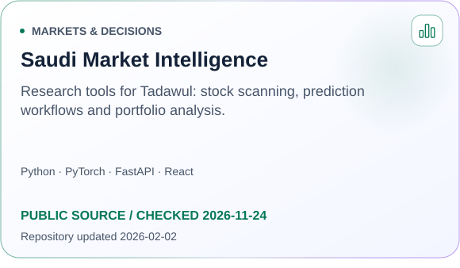
</picture></a>
<a href="https://github.com/Abdulrahman-S-Asiri/Bidaya_v2"><picture>
  <source media="(max-width: 600px) and (prefers-color-scheme: dark)" srcset="assets/portfolio/bidaya-mobile-dark.svg">
  <source media="(max-width: 600px) and (prefers-color-scheme: light)" srcset="assets/portfolio/bidaya-mobile-light.svg">
  <source media="(prefers-color-scheme: dark)" srcset="assets/portfolio/bidaya-dark.svg">
  <source media="(prefers-color-scheme: light)" srcset="assets/portfolio/bidaya-light.svg">
  
</picture></a>
<a href="https://github.com/Abdulrahman-S-Asiri/Data_Science_Basics"><picture>
  <source media="(max-width: 600px) and (prefers-color-scheme: dark)" srcset="assets/portfolio/data-science-basics-mobile-dark.svg">
  <source media="(max-width: 600px) and (prefers-color-scheme: light)" srcset="assets/portfolio/data-science-basics-mobile-light.svg">
  <source media="(prefers-color-scheme: dark)" srcset="assets/portfolio/data-science-basics-dark.svg">
  <source media="(prefers-color-scheme: light)" srcset="assets/portfolio/data-science-basics-light.svg">
  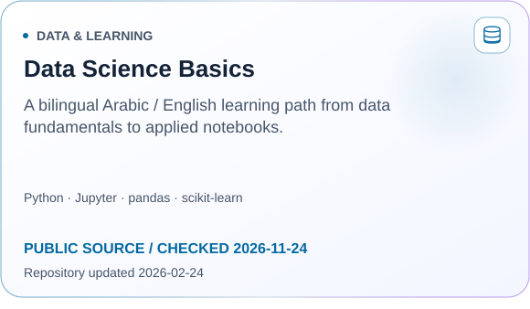
</picture></a>
<a href="https://github.com/Abdulrahman-S-Asiri/sentiment-analysis-project-Final"><picture>
  <source media="(max-width: 600px) and (prefers-color-scheme: dark)" srcset="assets/portfolio/sentiment-insight-mobile-dark.svg">
  <source media="(max-width: 600px) and (prefers-color-scheme: light)" srcset="assets/portfolio/sentiment-insight-mobile-light.svg">
  <source media="(prefers-color-scheme: dark)" srcset="assets/portfolio/sentiment-insight-dark.svg">
  <source media="(prefers-color-scheme: light)" srcset="assets/portfolio/sentiment-insight-light.svg">
  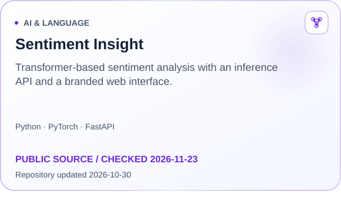
</picture></a>
<a href="https://github.com/Abdulrahman-S-Asiri/Mindmaps"><picture>
  <source media="(max-width: 600px) and (prefers-color-scheme: dark)" srcset="assets/portfolio/mindmaps-mobile-dark.svg">
  <source media="(max-width: 600px) and (prefers-color-scheme: light)" srcset="assets/portfolio/mindmaps-mobile-light.svg">
  <source media="(prefers-color-scheme: dark)" srcset="assets/portfolio/mindmaps-dark.svg">
  <source media="(prefers-color-scheme: light)" srcset="assets/portfolio/mindmaps-light.svg">
  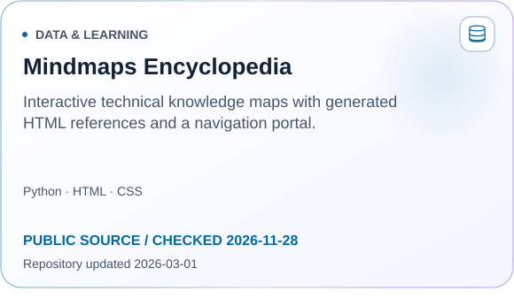
</picture></a>
<a href="https://github.com/Abdulrahman-S-Asiri/tasamuh-vr"><picture>
  <source media="(max-width: 600px) and (prefers-color-scheme: dark)" srcset="assets/portfolio/tasamuh-vr-mobile-dark.svg">
  <source media="(max-width: 600px) and (prefers-color-scheme: light)" srcset="assets/portfolio/tasamuh-vr-mobile-light.svg">
  <source media="(prefers-color-scheme: dark)" srcset="assets/portfolio/tasamuh-vr-dark.svg">
  <source media="(prefers-color-scheme: light)" srcset="assets/portfolio/tasamuh-vr-light.svg">
  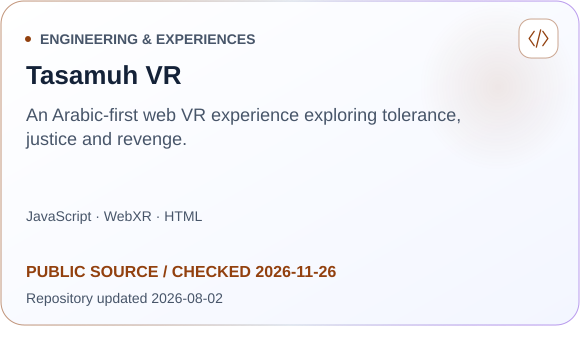
</picture></a>
<a href="https://github.com/Abdulrahman-S-Asiri/Cyber-Awareness"><picture>
  <source media="(max-width: 600px) and (prefers-color-scheme: dark)" srcset="assets/portfolio/cyber-awareness-mobile-dark.svg">
  <source media="(max-width: 600px) and (prefers-color-scheme: light)" srcset="assets/portfolio/cyber-awareness-mobile-light.svg">
  <source media="(prefers-color-scheme: dark)" srcset="assets/portfolio/cyber-awareness-dark.svg">
  <source media="(prefers-color-scheme: light)" srcset="assets/portfolio/cyber-awareness-light.svg">
  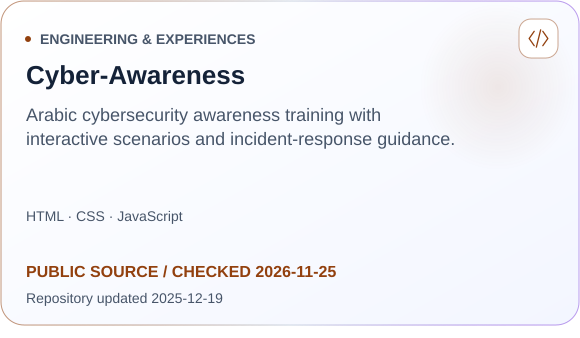
</picture></a>

Saudi Market Intelligence sources

<strong>Market data to research tools</strong>

<ul>
<li><strong>Collect</strong> · Market-data loaders supply prices and technical features.</li>
<li><strong>Analyze</strong> · Python analysis and model modules expose research through FastAPI.</li>
<li><strong>Inspect</strong> · React views organize stock analysis, scanning and portfolio research.</li>
</ul>

<a href="https://github.com/Abdulrahman-S-Asiri/saudi-market-intelligence">Saudi Market Intelligence repository</a> · <a href="https://github.com/Abdulrahman-S-Asiri/saudi-market-intelligence/blob/7a43abebfd509111ec2f8452c440a79576922be3/README.md">Architecture and API</a>

Bidaya preview and sources

<strong>Arabic and English interview practice</strong>

<em>Interface preview · Configure a bilingual interview practice session.</em>

<ul>
<li><strong>Prepare</strong> · Choose an interview context in the Arabic / English interface.</li>
<li><strong>Practice</strong> · Work through interview questions and responses.</li>
<li><strong>Reflect</strong> · Explore the feedback and resume-analysis features described in the project.</li>
</ul>

<a href="https://github.com/Abdulrahman-S-Asiri/Bidaya_v2">Bidaya repository</a> · <a href="https://github.com/Abdulrahman-S-Asiri/Bidaya_v2/blob/ded111aa503513051378a9f3e7c7e789516ba4bd/README.md">Project guide</a> · <a href="https://github.com/Abdulrahman-S-Asiri/Bidaya_v2/blob/ded111aa503513051378a9f3e7c7e789516ba4bd/frontend/src/pages/Home.jsx">Interface source</a>

### Published releases · آخر الإصدارات

No published stable releases were verified in this snapshot. Repository activity remains visible on each source card.

Source evidence and synchronization status

| Project | Source check | Latest stable release | Latest completed workflow on default branch |
|:---|:---|:---|:---|
| <a href="https://github.com/Abdulrahman-S-Asiri/saudi-market-intelligence">Saudi Market Intelligence</a> | current · 2026-11-25 | No stable release reported | No completed run reported |
| <a href="https://github.com/Abdulrahman-S-Asiri/Bidaya_v2">Bidaya</a> | current · 2026-11-25 | No stable release reported | No completed run reported |
| <a href="https://github.com/Abdulrahman-S-Asiri/Data_Science_Basics">Data Science Basics</a> | current · 2026-11-25 | No stable release reported | No completed run reported |
| <a href="https://github.com/Abdulrahman-S-Asiri/sentiment-analysis-project-Final">Sentiment Insight</a> | current · 2026-11-25 | No stable release reported | No completed run reported |
| <a href="https://github.com/Abdulrahman-S-Asiri/Mindmaps">Mindmaps Encyclopedia</a> | current · 2026-11-25 | No stable release reported | <a href="https://github.com/Abdulrahman-S-Asiri/Mindmaps/actions/runs/22548619511">pages build and deployment: success</a> · 2026-11-22 |
| <a href="https://github.com/Abdulrahman-S-Asiri/tasamuh-vr">Tasamuh VR</a> | current · 2026-11-25 | No stable release reported | No completed run reported |
| <a href="https://github.com/Abdulrahman-S-Asiri/Cyber-Awareness">Cyber-Awareness</a> | current · 2026-11-25 | No stable release reported | No completed run reported |

A workflow result describes that workflow only. Project scope, model calibration, production readiness and financial performance require their own evidence.

Discovery check: **current**. Add the `portfolio-profile` topic to an eligible public repository to include it automatically.

## Private work · ملخصات الأعمال الخاصة

These curated summaries reuse scope already published in this profile. Private repositories are not queried.

<picture>
  <source media="(max-width: 600px) and (prefers-color-scheme: dark)" srcset="assets/portfolio/stock-agents-mobile-dark.svg">
  <source media="(max-width: 600px) and (prefers-color-scheme: light)" srcset="assets/portfolio/stock-agents-mobile-light.svg">
  <source media="(prefers-color-scheme: dark)" srcset="assets/portfolio/stock-agents-dark.svg">
  <source media="(prefers-color-scheme: light)" srcset="assets/portfolio/stock-agents-light.svg">
  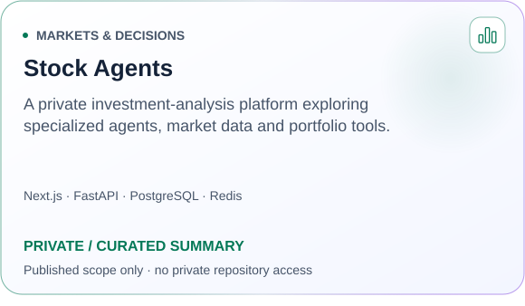
</picture>
<picture>
  <source media="(max-width: 600px) and (prefers-color-scheme: dark)" srcset="assets/portfolio/codeforge-mobile-dark.svg">
  <source media="(max-width: 600px) and (prefers-color-scheme: light)" srcset="assets/portfolio/codeforge-mobile-light.svg">
  <source media="(prefers-color-scheme: dark)" srcset="assets/portfolio/codeforge-dark.svg">
  <source media="(prefers-color-scheme: light)" srcset="assets/portfolio/codeforge-light.svg">
  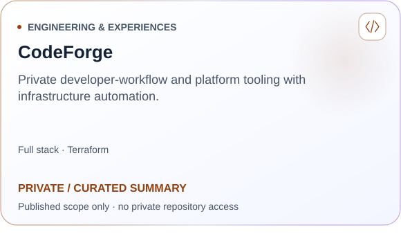
</picture>
<picture>
  <source media="(max-width: 600px) and (prefers-color-scheme: dark)" srcset="assets/portfolio/stock-101-mobile-dark.svg">
  <source media="(max-width: 600px) and (prefers-color-scheme: light)" srcset="assets/portfolio/stock-101-mobile-light.svg">
  <source media="(prefers-color-scheme: dark)" srcset="assets/portfolio/stock-101-dark.svg">
  <source media="(prefers-color-scheme: light)" srcset="assets/portfolio/stock-101-light.svg">
  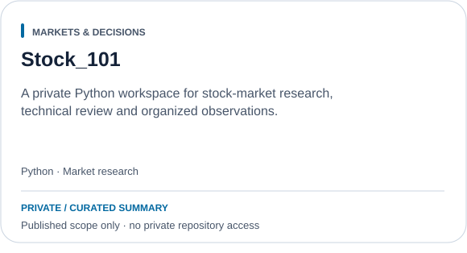
</picture>

<!-- portfolio:end -->

---

## About · نبذة

I'm **Abdulrahman Saad Asiri · عبدالرحمن سعد عسيري**, a **Data Engineer at stc** in Riyadh. I build data systems, Arabic AI applications and tools for market research.

  <a href="https://www.linkedin.com/in/abdulrahman-saad-asiri-573ba1200">LinkedIn</a> ·
  <a href="mailto:abdulrahman.s.alasiri@gmail.com">Email</a> ·
  <a href="https://huggingface.co/Abdulrahman-S-Asiri">Hugging Face</a> ·
  <a href="https://x.com/D7oomyStay">X</a>

## Explore by interest · استكشف حسب اهتمامك

| Interest | Start here |
|:---|:---|
| Markets and decision tools | Saudi Market Intelligence, Stock Agents and Stock_101 |
| Arabic AI and applications | Bidaya, Sentiment Insight and the research links below |
| Data and learning | Data Science Basics and Mindmaps Encyclopedia |
| Engineering and experiences | Cyber-Awareness, Tasamuh VR and the curated CodeForge summary |

## Research and community · البحث والمجتمع

| Work listed in this portfolio | Focus |
|:---|:---|
| [SA-Retrieval Embeddings 0.2B](https://huggingface.co/Omartificial-Intelligence-Space/SA-Retrieval-Embeddings-0.2B) | Retrieval for Saudi Arabic and Modern Standard Arabic |
| [SAFIR Leaderboard](https://huggingface.co/spaces/NAMAA-Space/SAFIR-Leaderboard) | Arabic AI benchmarks and model evaluation |
| [ServeDoctorBench · Research Poster (PDF)](docs/research/Tasaru_A0_ServeDoctorBench.pdf) | Tuwaiq Academy Demo Day 2026 team poster. We compared how seven language models diagnosed faults, cited evidence and chose safe next actions across 62 vLLM serving cases. |

Model-specific metrics, datasets and evaluation assumptions belong with their original sources.

### ServeDoctorBench · A healthy vLLM run

On an **A100-SXM4-80GB**, I measured **24 requests** after excluding **3 warm-ups**. Time to first token ranged from **19–53 ms**, with a mean of **34 ms**.

[My role and measurement · دوري في البحث](docs/research/servedoctorbench-case-study.md) · [Team poster (PDF)](docs/research/Tasaru_A0_ServeDoctorBench.pdf)

## Technical range · المهارات

| Area | Tools and interests |
|:---|:---|
| Data engineering | Python, SQL, pandas, NumPy, PostgreSQL, Redis, Jupyter, Tableau |
| Models and evaluation | PyTorch, TensorFlow, Transformers, scikit-learn, XGBoost, embeddings, RAG, LLM agents |
| Applications and delivery | FastAPI, Flask, REST APIs, WebSockets, TypeScript, JavaScript, React, Next.js, Vite, Tailwind CSS, Git, Docker, Terraform, GitHub Actions |
| Market research | Tadawul, US equities, technical analysis, portfolio analytics |

## Education and experience · التعليم والخبرة

I work in data engineering at **stc** in Riyadh and hold a **B.Sc. in Computer Science** from Majmaah University.

- **Data Science & AI Bootcamp** · Tuwaiq Academy, 2025. Exploratory analysis, model evaluation and NLP.
- **Tasaru · AI Infrastructure Bootcamp** · Tuwaiq Academy, June–August 2026. GPU performance, LLM serving and agents.

My background includes DataCamp’s Data Scientist Associate, NVIDIA’s Deep Learning Fundamentals, and leading the Investment Committees and Financial Analysis at the Investment Club. I’m studying production LLM architecture and the Chartered Market Technician program as a CMT candidate.

What I studied at Tuwaiq · ما درسته في طويق

**Data science and AI.** I studied exploratory data analysis, regression and classification, cross-validation and text preprocessing for NLP. [Bootcamp at Tuwaiq Academy](https://tuwaiq.edu.sa/bootcamp/w8z310gY/view)

In my loan-classification exercise, I dropped a score that could reveal the approval decision. Logistic regression then classified 375 of 400 held-out synthetic applications correctly. [View the notebook and confusion matrix](docs/learning/loan-approval.ipynb)

| Actual outcome | Predicted rejection | Predicted approval |
|:---|---:|---:|
| Rejected | 213 | 11 |
| Approved | 14 | 162 |

**Tasaru.** I studied how to profile GPU workloads, distribute model training across GPUs and serve language models. The labs covered attention, KV caching and agents that call tools. Our team explored how models diagnose faults in a running vLLM service. [Tasaru at Tuwaiq Academy](https://tuwaiq.edu.sa/bootcamp/qNKbNKnX/view) · [Team research poster (PDF)](docs/research/Tasaru_A0_ServeDoctorBench.pdf)

## How I build · منهجي

I start with a question, define what to measure and test the main workflow and its failure cases. I document the limits of the evidence and disclose meaningful AI assistance. [Engineering method](docs/AI_ENGINEERING_METHOD.md) · [Repository launch playbook](docs/REPO_LAUNCH_PLAYBOOK.md)

## Keep this portfolio current

Public project data is refreshed hourly. [How to add a project or update the gallery](docs/LIVING_PORTFOLIO.md)

## Connect · تواصل

[LinkedIn](https://www.linkedin.com/in/abdulrahman-saad-asiri-573ba1200) · [Email](mailto:abdulrahman.s.alasiri@gmail.com) · [Hugging Face](https://huggingface.co/Abdulrahman-S-Asiri) · [X](https://x.com/D7oomyStay)
