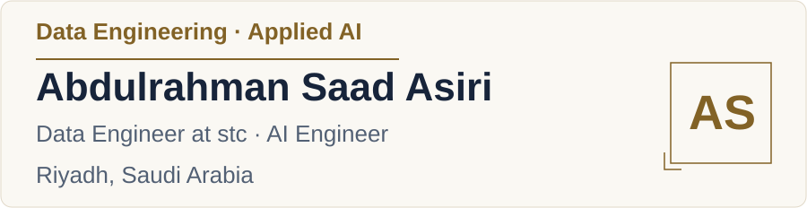
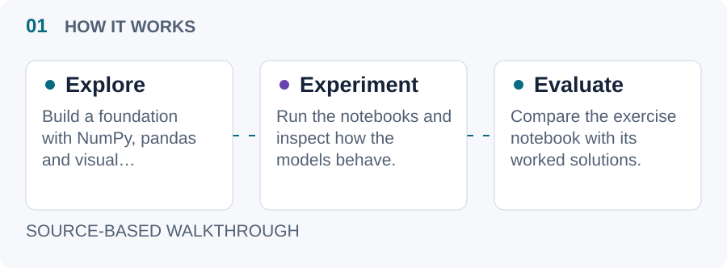
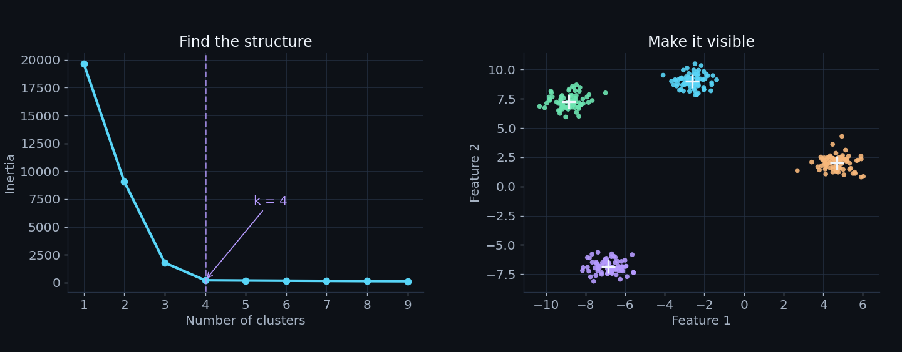
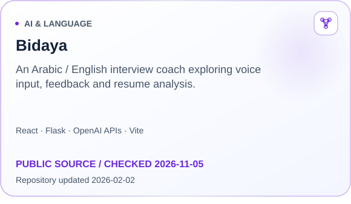
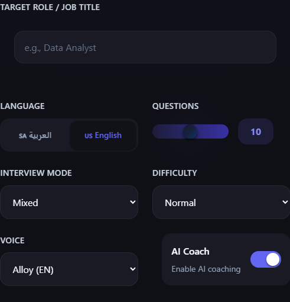
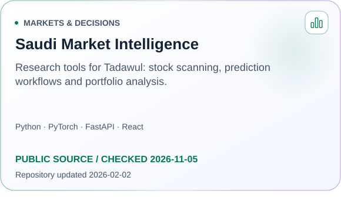
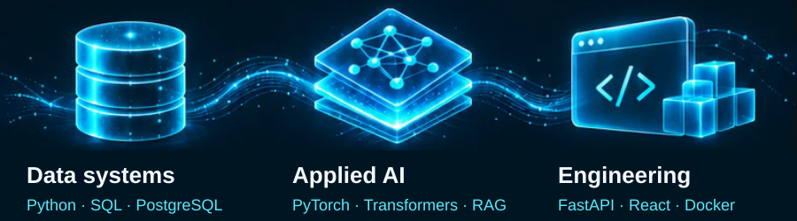
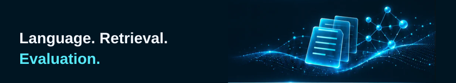

<!-- Banner assets are generated; the introduction and sections outside the markers are hand-authored. -->

<picture>
  <source media="(max-width: 900px) and (prefers-reduced-motion: reduce)" srcset="assets/portfolio/banner-mobile-still.svg">
  <source media="(prefers-reduced-motion: reduce)" srcset="assets/portfolio/banner-still.svg">
  <source media="(max-width: 900px) and (prefers-color-scheme: dark)" srcset="assets/portfolio/banner-mobile-dark.svg">
  <source media="(max-width: 900px) and (prefers-color-scheme: light)" srcset="assets/portfolio/banner-mobile-light.svg">
  <source media="(prefers-color-scheme: dark)" srcset="assets/portfolio/banner-dark.svg">
  <source media="(prefers-color-scheme: light)" srcset="assets/portfolio/banner-light.svg">
  
</picture>

I build **data systems, Arabic AI and tools for market research**.

[LinkedIn ↗](https://www.linkedin.com/in/abdulrahman-saad-asiri-573ba1200) · [Email ↗](mailto:abdulrahman.s.alasiri@gmail.com) · [Hugging Face ↗](https://huggingface.co/Abdulrahman-S-Asiri)

<!-- portfolio:start -->

## Selected Work · أعمال مختارة

<a href="https://github.com/Abdulrahman-S-Asiri/Data_Science_Basics"><picture>
  <source media="(max-width: 900px) and (prefers-color-scheme: dark)" srcset="assets/portfolio/data-science-basics-mobile-dark.svg">
  <source media="(max-width: 900px) and (prefers-color-scheme: light)" srcset="assets/portfolio/data-science-basics-mobile-light.svg">
  <source media="(prefers-color-scheme: dark)" srcset="assets/portfolio/data-science-basics-dark.svg">
  <source media="(prefers-color-scheme: light)" srcset="assets/portfolio/data-science-basics-light.svg">
  
</picture></a>

<strong>Explore Data Science Basics</strong> · <a href="https://github.com/Abdulrahman-S-Asiri/Data_Science_Basics">View project ↗</a>

Bilingual data fundamentals and applied notebooks.

1. **Explore** — Build a foundation with NumPy, pandas and visual exploration.
2. **Experiment** — Run the notebooks and inspect how the models behave.
3. **Evaluate** — Compare the exercise notebook with its worked solutions.

<strong>Built with</strong> · Python · Jupyter · pandas · scikit-learn

<picture>
<source media="(max-width: 900px)" srcset="assets/showcases/data-science-basics-mobile.png">

</picture>

Notebook example · K-means clustering with synthetic data.

<a href="https://github.com/Abdulrahman-S-Asiri/Data_Science_Basics/blob/043375eb72da8f4ade97860bd9674c3441ad49cc/Data_Science_Basics.ipynb">Exercise notebook</a> · <a href="https://github.com/Abdulrahman-S-Asiri/Data_Science_Basics/blob/043375eb72da8f4ade97860bd9674c3441ad49cc/Data_Science_Basics_Solve.ipynb">Worked notebook</a>

<a href="https://github.com/Abdulrahman-S-Asiri/Bidaya_v2"><picture>
  <source media="(max-width: 900px) and (prefers-color-scheme: dark)" srcset="assets/portfolio/bidaya-mobile-dark.svg">
  <source media="(max-width: 900px) and (prefers-color-scheme: light)" srcset="assets/portfolio/bidaya-mobile-light.svg">
  <source media="(prefers-color-scheme: dark)" srcset="assets/portfolio/bidaya-dark.svg">
  <source media="(prefers-color-scheme: light)" srcset="assets/portfolio/bidaya-light.svg">
  
</picture></a>

<strong>Explore Bidaya</strong> · <a href="https://github.com/Abdulrahman-S-Asiri/Bidaya_v2">View project ↗</a>

Arabic / English interview coaching.

1. **Prepare** — Choose an interview context in the Arabic / English interface.
2. **Practice** — Work through interview questions and responses.
3. **Reflect** — Explore the feedback and resume-analysis features described in the project.

<strong>Built with</strong> · React · Flask · OpenAI APIs · Vite

Interface preview · Configure a bilingual interview practice session.

<a href="https://github.com/Abdulrahman-S-Asiri/Bidaya_v2/blob/ded111aa503513051378a9f3e7c7e789516ba4bd/README.md">Project guide</a> · <a href="https://github.com/Abdulrahman-S-Asiri/Bidaya_v2/blob/ded111aa503513051378a9f3e7c7e789516ba4bd/frontend/src/pages/Home.jsx">Interface source</a>

<a href="https://github.com/Abdulrahman-S-Asiri/saudi-market-intelligence"><picture>
  <source media="(max-width: 900px) and (prefers-color-scheme: dark)" srcset="assets/portfolio/saudi-market-intelligence-mobile-dark.svg">
  <source media="(max-width: 900px) and (prefers-color-scheme: light)" srcset="assets/portfolio/saudi-market-intelligence-mobile-light.svg">
  <source media="(prefers-color-scheme: dark)" srcset="assets/portfolio/saudi-market-intelligence-dark.svg">
  <source media="(prefers-color-scheme: light)" srcset="assets/portfolio/saudi-market-intelligence-light.svg">
  
</picture></a>

<strong>Explore Saudi Market Intelligence</strong> · <a href="https://github.com/Abdulrahman-S-Asiri/saudi-market-intelligence">View project ↗</a>

Research tools for Tadawul.

1. **Collect** — Market-data loaders supply prices and technical features.
2. **Analyze** — Python analysis and model modules expose research through FastAPI.
3. **Inspect** — React views organize stock analysis, scanning and portfolio research.

<strong>Built with</strong> · Python · PyTorch · FastAPI · React

<a href="https://github.com/Abdulrahman-S-Asiri/saudi-market-intelligence/blob/7a43abebfd509111ec2f8452c440a79576922be3/README.md">Architecture and API</a>

<strong>More Projects · مشاريع أخرى</strong>

<strong><a href="https://github.com/Abdulrahman-S-Asiri/sentiment-analysis-project-Final">Sentiment Insight</a></strong> — Transformer-based sentiment analysis with an inference API and a branded web interface.

<strong><a href="https://github.com/Abdulrahman-S-Asiri/Mindmaps">Mindmaps Encyclopedia</a></strong> — Interactive technical knowledge maps with generated HTML references and a navigation portal.

<strong><a href="https://github.com/Abdulrahman-S-Asiri/tasamuh-vr">Tasamuh VR</a></strong> — An Arabic-first web VR experience exploring tolerance, justice and revenge.

<strong><a href="https://github.com/Abdulrahman-S-Asiri/Cyber-Awareness">Cyber-Awareness</a></strong> — Arabic cybersecurity awareness training with interactive scenarios and incident-response guidance.

<strong>Private Work · أعمال خاصة</strong>

Published summaries only. Private repositories are not queried.

<strong>Stock Agents</strong> — A private investment-analysis platform exploring specialized agents, market data and portfolio tools.

<strong>CodeForge</strong> — Private developer-workflow and platform tooling with infrastructure automation.

<strong>Stock_101</strong> — A private Python workspace for stock-market research, technical review and organized observations.

<strong>Source Details · المصادر والتحديثات</strong>

Public sources checked on **2026-11-14 UTC** · 7/7 source checks succeeded.

<strong>Data Science Basics</strong> · Python · Jupyter · pandas · scikit-learn

<strong>Bidaya</strong> · React · Flask · OpenAI APIs · Vite

<strong>Saudi Market Intelligence</strong> · Python · PyTorch · FastAPI · React

| Project | Source check | Latest stable release | Latest completed workflow on default branch |
|:---|:---|:---|:---|
| <a href="https://github.com/Abdulrahman-S-Asiri/Data_Science_Basics">Data Science Basics</a> | current · 2026-11-14 | No stable release reported | No completed run reported |
| <a href="https://github.com/Abdulrahman-S-Asiri/Bidaya_v2">Bidaya</a> | current · 2026-11-14 | No stable release reported | No completed run reported |
| <a href="https://github.com/Abdulrahman-S-Asiri/saudi-market-intelligence">Saudi Market Intelligence</a> | current · 2026-11-14 | No stable release reported | No completed run reported |
| <a href="https://github.com/Abdulrahman-S-Asiri/sentiment-analysis-project-Final">Sentiment Insight</a> | current · 2026-11-14 | No stable release reported | No completed run reported |
| <a href="https://github.com/Abdulrahman-S-Asiri/Mindmaps">Mindmaps Encyclopedia</a> | current · 2026-11-14 | No stable release reported | <a href="https://github.com/Abdulrahman-S-Asiri/Mindmaps/actions/runs/22548619511">pages build and deployment: success</a> · 2026-03-01 |
| <a href="https://github.com/Abdulrahman-S-Asiri/tasamuh-vr">Tasamuh VR</a> | current · 2026-11-14 | No stable release reported | No completed run reported |
| <a href="https://github.com/Abdulrahman-S-Asiri/Cyber-Awareness">Cyber-Awareness</a> | current · 2026-11-14 | No stable release reported | No completed run reported |

A workflow result describes that workflow only. Project scope, model calibration, production readiness and financial performance require their own evidence.

Discovery check: **current**. Add the `portfolio-profile` topic to an eligible public repository to include it automatically.

<!-- portfolio:end -->

## Engineering Toolkit · الأدوات

<picture>
  <source media="(max-width: 900px) and (prefers-color-scheme: dark)" srcset="assets/portfolio/toolkit-mobile-dark.svg">
  <source media="(max-width: 900px) and (prefers-color-scheme: light)" srcset="assets/portfolio/toolkit-mobile-light.svg">
  <source media="(prefers-color-scheme: dark)" srcset="assets/portfolio/toolkit-dark.svg">
  <source media="(prefers-color-scheme: light)" srcset="assets/portfolio/toolkit-light.svg">
  
</picture>

## Research & Community · البحث

<picture>
  <source media="(max-width: 900px) and (prefers-color-scheme: dark)" srcset="assets/portfolio/research-mobile-dark.svg">
  <source media="(max-width: 900px) and (prefers-color-scheme: light)" srcset="assets/portfolio/research-mobile-light.svg">
  <source media="(prefers-color-scheme: dark)" srcset="assets/portfolio/research-dark.svg">
  <source media="(prefers-color-scheme: light)" srcset="assets/portfolio/research-light.svg">
  
</picture>

[SA-Retrieval Embeddings 0.2B ↗](https://huggingface.co/Omartificial-Intelligence-Space/SA-Retrieval-Embeddings-0.2B) — Saudi Arabic and Modern Standard Arabic retrieval.

[SAFIR Leaderboard ↗](https://huggingface.co/spaces/NAMAA-Space/SAFIR-Leaderboard) — Arabic AI benchmarks and evaluation.

<strong>Background & learning · التعليم والتعلّم</strong>

- **Data Engineer** — stc (Saudi Telecom Company).
- **B.Sc. Computer Science** — Majmaah University.
- **Data Science & AI Bootcamp** — Tuwaiq Academy.
- **CMT candidate** — Chartered Market Technician program.
- **Data Scientist Associate** — DataCamp.
- **Deep Learning Fundamentals** — NVIDIA.
- **Investment Club:** Head of Investment Committees and Head of Financial Analysis.

Currently learning production LLM architecture and the Chartered Market Technician program.

### Toolkit

- **Data systems** — Python, SQL, PostgreSQL, Redis, pandas and data workflows.
- **Applied AI** — PyTorch, Transformers, embeddings, RAG and LLM agents.
- **Engineering & delivery** — FastAPI, React, TypeScript, Docker and GitHub Actions.

### How I Build · منهجي

Start with a clear problem. Choose the smallest useful implementation. Make data contracts and model behavior measurable, verify failure cases, and document the decisions and limitations.

I own the engineering decisions and disclose meaningful AI assistance. [Read the method ↗](docs/AI_ENGINEERING_METHOD.md)

Research metrics, datasets and evaluation assumptions remain with their original sources.

<picture>
  <source media="(max-width: 900px) and (prefers-color-scheme: dark)" srcset="assets/portfolio/connect-mobile-dark.svg">
  <source media="(max-width: 900px) and (prefers-color-scheme: light)" srcset="assets/portfolio/connect-mobile-light.svg">
  <source media="(prefers-color-scheme: dark)" srcset="assets/portfolio/connect-dark.svg">
  <source media="(prefers-color-scheme: light)" srcset="assets/portfolio/connect-light.svg">
  
</picture>

Open to conversations around **data platforms · applied AI · Arabic NLP · market research**.

[LinkedIn ↗](https://www.linkedin.com/in/abdulrahman-saad-asiri-573ba1200) · [Email ↗](mailto:abdulrahman.s.alasiri@gmail.com) · [Hugging Face ↗](https://huggingface.co/Abdulrahman-S-Asiri) · [X ↗](https://x.com/D7oomyStay)

[Portfolio maintenance](docs/LIVING_PORTFOLIO.md) · [Engineering method](docs/AI_ENGINEERING_METHOD.md)
